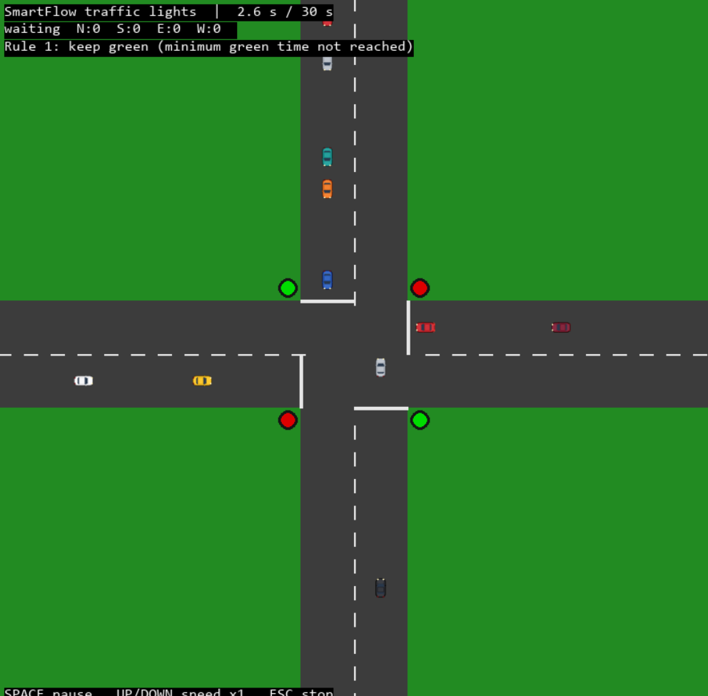

# SmartFlow
A traffic management simulation of a four-way intersection that compares normal timer-based traffic lights with SmartFlow, a rule-based light that reacts to the traffic.



## Overview
Normal traffic lights change on a fixed timer, so they keep giving green to a road with no cars while a long line builds up on the other road. SmartFlow looks at the actual traffic (how many cars are waiting, how long they have waited, and which cars are approaching) and uses rules to decide when to switch.

The project simulates individual cars with Agent-Based Modeling (AgentPy), decides the SmartFlow light with Rule-Based Reasoning, and shows the intersection with Pygame. The goal is to find out whether the adaptive light improves traffic flow and reduces waiting time compared with a normal timer.

## Features
- Cars are individual agents that follow the light and the car in front of them
- Two modes: Normal traffic lights and SmartFlow traffic lights
- A Pygame window that shows the roads, cars, lights and waiting queues
- Results printed in the terminal after every run
- compare.py for averaged comparisons over several runs and traffic patterns
- Fully seeded, so the same seed gives the same traffic for both lights

## How It Works
### Cars
Each car does this in each simulation step:
- Move along is lane
- Checks its traffic light. On red it brakes to stop 4 pixels before the stop line. On yellow it only stops if it still has enough room to stop in time.
- Checks the car in front and slows down so it keeps a safe gap.
- Speeds up or slows down toward the safe speed, then moves forward.
- Counts the steps it spends stopped before the stop line (its waiting time).

### Modes
Depending the chosen mode, the car's follow the traffic light accordingly.  
The two main traffic lights mode:  
1. **Normal Traffic Lights** - A plain timer is used here. The cycle is: North/South green (5 s) → yellow (1 s) → all red (0.5 s) → East/West green (5 s) → yellow (1 s) → all red (0.5 s) → repeat. It never looks at the traffic. 

2. **SmartFLow Traffic Lights** - Only one road (North/South or East/West) has green at a time. While a road has green, these rules are checked every step, in order:
- Keep green if the minimum green time (3 s) has not passed.
- Keep green if nobody is waiting on the other road.
- Switch if the maximum green time (10 s) has been reached.
- Switch if the green road is empty (no cars waiting or approaching).
- Switch if the other road has much more waiting pressure than the green road.
- Otherwise keep green.

## How To Run
### Setup
Use this command to install the libraries used:
```bash
pip install -r requirements.txt
```
### Running the simulation
To run SmartFlow, simply run `main.py`

Terminal will prompt you to:
```bash
SmartFlow traffic simulation
  1 = Normal traffic lights
  2 = SmartFlow traffic lights
Enter 1 or 2 (q to quit):
```
Type either `1` or `2` to pick which mode you would like to see. After that, a `pygame` window will pop up that runs the simulation.
The simulation will last 30 seconds then closes itself aftwards. The results of the run will be printed in the terminal after an individual run.

During the run, you can:
| Key | Action |
|---|---|
| `SPACE` | Pauses the run |
| `UP` | Speeds up the run |
| `DOWN` | Slows down the run |
| `ESC` |  Stops the run   |

### Running Averaged Comparison of Both Modes
Simply run `compare.py` or through this command:
```bash 
python compare.py
```
Runs both lights on three traffic patterns, 5 runs each, prints an averaged table per pattern and saves `results.csv`. The three patterns are:
- *Default*: North/South busier than East/West
- *Uneven*: North/South heavy, East/West light
- *Even*: the same traffic in every lane

## Comparison on Both Modes
### Metrics
| Metric | Meaning |
|---|---|
| Average wait | The average time a car spent stopped before the stop line |
| Longest wait | The longest time any single car spent stopped
| Cars that had to stop	| The percentage of cars that stopped at least once
| Avg cars waiting | The average number of stopped cars (all lanes together) during the run
| Cars passed in 30 s |	How many cars had passed through the intersection when arrivals stopped
| Time to clear all	| How long until the last car left the road

### Results:
### Default traffic (North/South busier):
| Metric | Normal | SmartFlow |	Change |
|---|---|---|---|
| Average wait | 2.8 s | 2.3 s | -17% |
| Longest wait | 7.6 s | 6.8 s | -11% |
| Cars that had to stop	| 71% | 73%	| +2% |
| Avg cars waiting | 6.3 | 5.7 |-9% |
| Cars passed in 30 s | 66 s | 71	| +9% |
| Time to clear all | 42.5 s | 39.7 s | -7% |

### Uneven traffic (North/South busier):
| Metric | Normal | SmartFlow |	Change |
|---|---|---|---|
| Average wait | 2.9 s | 2.3 s | -21% |
| Longest wait | 7.6 s | 6.7 s | -13% |
| Cars that had to stop	| 69% | 71%	| +3% |
| Avg cars waiting | 5.8  | 5.2 |-10% |
| Cars passed in 30 s | 56 | 68 | +23% |
| Time to clear all | 42.6 s | 38.8 s | -9% |

### Even traffic (North/South busier):
| Metric | Normal | SmartFlow |	Change |
|---|---|---|---|
| Average wait | 2.7 s | 2.2 s | -21% |
| Longest wait | 7.6 s | 6.2 s | -18% |
| Cars that had to stop	| 70% | 68%	| -3% |
| Avg cars waiting | 6.0 | 5.1 |-15% |
| Cars passed in 30 s | 65 | 65	| -1% |
| Time to clear all | 41.6 s | 39.0 s | -6% |

## The Team

*Crisostomo, Jerome M.*  
BSCSSE | AN 42 | FEU-A  
Frontend Dev

*Liggayu, Michael Dominic l.*  
BSCSSE | AN 42 | FEU-A  
Documentation Team

*Salvador, Chritain Dave K.*  
BSCSSE | AN 42 | FEU-A  
Documentation Team

*Tividad, Eric Jr V.*  
BSCSSE | AN 42 | FEU-A  
Project Leader & Backend Dev

*Viado, Jose Miguel B.*  
BSCSSE | AN 42 | FEU-A  
Frontend Dev